<div align="center">


# Les reco de la cantine

**Le site privé où votre bande d'amis se recommande films, séries, livres, jeux vidéo, vidéos et musiques.**


-15803D)


[Fonctionnalités](#-ce-que-ça-fait) · [Tutoriel d'installation](#-tutoriel--installer-le-site-en-15-minutes) · [Mise à jour](#-mettre-à-jour) · [Sauvegarde](#-sauvegarder-et-restaurer) · [Dépannage](#-dépannage)

<br>

<table>
<tr>
<td>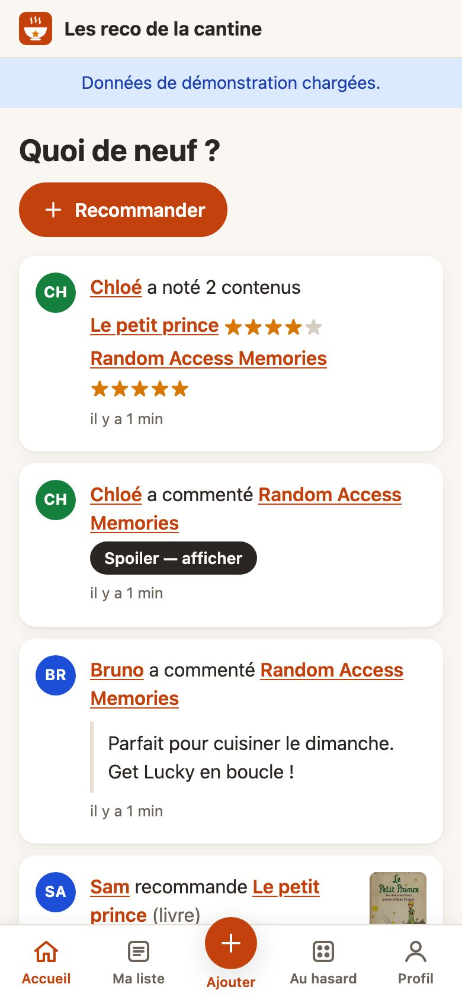</td>
<td>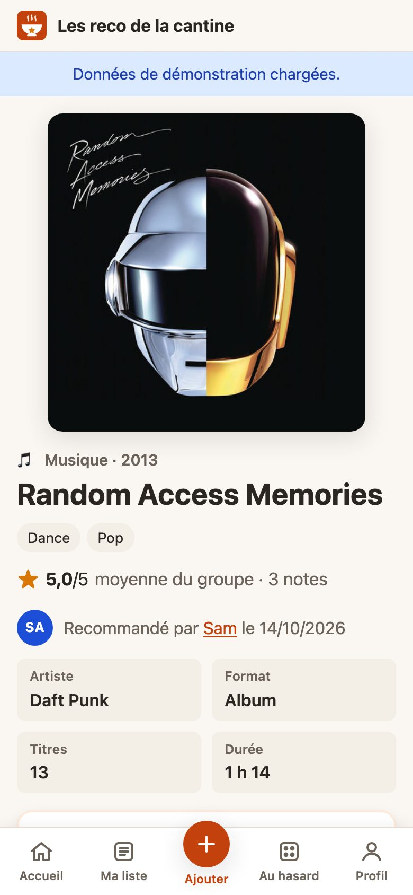</td>
<td>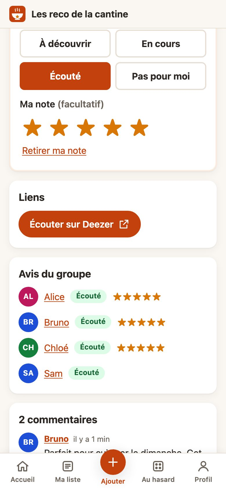</td>
</tr>
</table>

</div>

---

## 🍲 Ce que ça fait

Chacun a **son compte** et **sa liste**. Quand quelqu'un recommande un contenu, toute la bande le voit : on le coche quand on l'a vu, lu, joué ou écouté, on le note et on en discute.

| | |
|---|---|
| 🔎 **Recommander en 3 clics** | Choisissez le type, tapez un titre, sélectionnez : jaquette, année, genres, durée, auteur… tout est rempli automatiquement. Un lien YouTube collé suffit pour une vidéo. |
| ✍️ **Ajout manuel** | Rien trouvé ? Un formulaire simple prend le relais, avec détection des doublons. |
| 📋 **Ma liste** | Quatre statuts : *À découvrir*, *En cours*, *Vu* (ou *Lu*, *Joué*, *Écouté*), *Pas pour moi*. Filtres, tris, recherche, badge « nouveau ». |
| ⭐ **Notes de 1 à 5** | Facultatives, visibles de tous, avec la moyenne du groupe. |
| 💬 **Commentaires** | Avec une option *spoiler* qui masque le texte jusqu'au clic. |
| 📺 **Où regarder ?** | Plateformes de streaming disponibles en France pour les films et séries (données JustWatch). |
| 📚 **Où trouver le livre ?** | Liens vers Amazon, la Fnac et une librairie indépendante (configurables). |
| 🎲 **Que regarder ce soir ?** | Un tirage au sort dans votre liste, par type et par genre. |
| 📰 **Quoi de neuf** | Le fil des dernières recommandations, notes et commentaires du groupe. |
| 📱 **Comme une appli** | Pensé pour le téléphone, installable sur l'écran d'accueil (Android et iPhone). |
| 🛠️ **Administration** | Comptes des amis, réglages, sauvegarde et restauration en un clic, mode maintenance, diagnostic, données de démo. |

**Sans intelligence artificielle** et sans recommandation algorithmique : seulement les conseils des copains.
Pas de publicité, pas de pistage, vos données restent sur **votre** serveur.

<details>
<summary><b>🖼️ Plus de captures d'écran</b></summary>
<br>

| Ajouter | Rechercher | Au hasard | Se connecter |
|---|---|---|---|
| 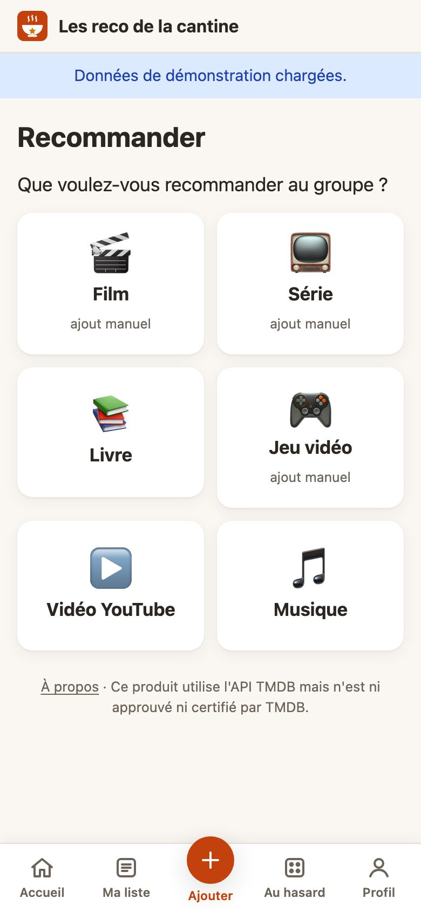 | 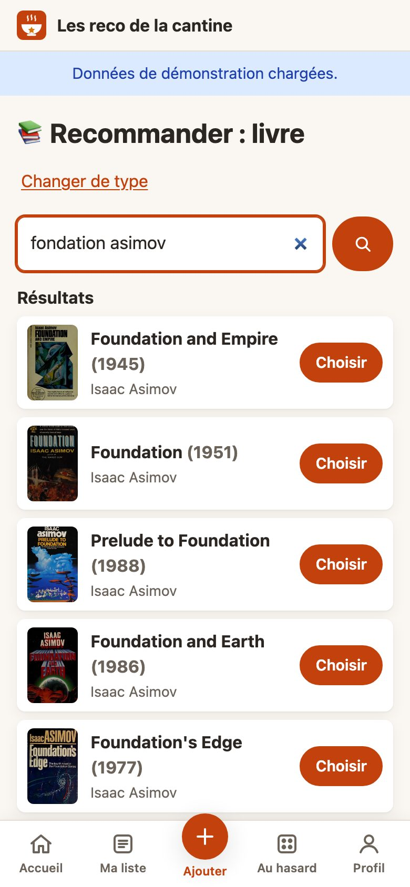 | 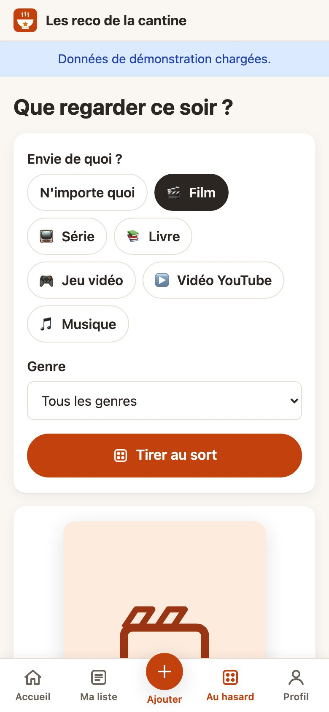 | 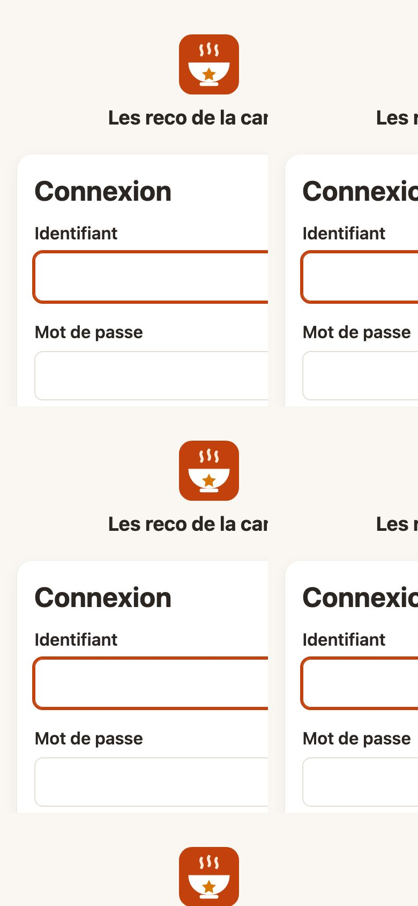 |

**Sur ordinateur**

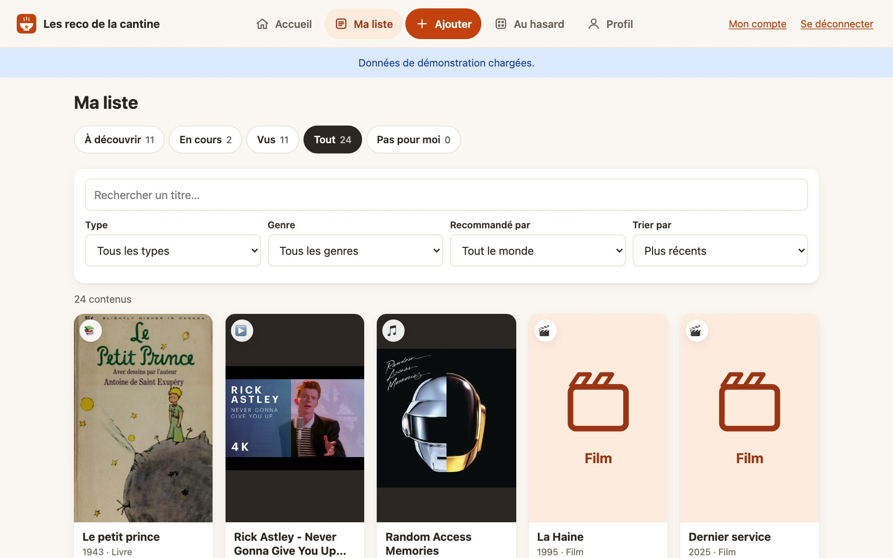
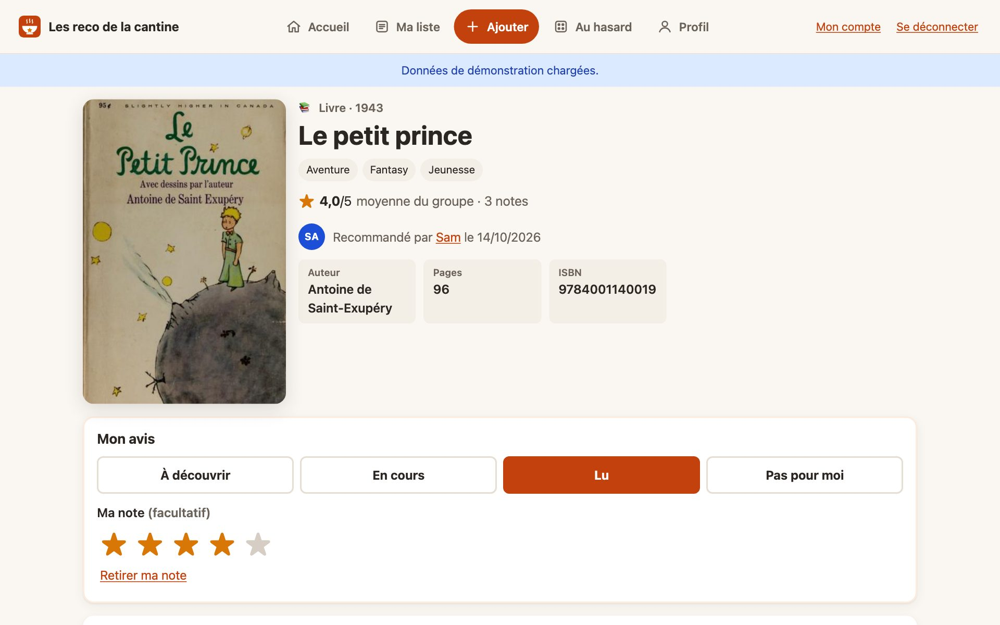

</details>

---

## 📖 Tutoriel : installer le site en 15 minutes

Aucune connaissance en programmation n'est nécessaire. Il faut juste savoir envoyer des fichiers sur un serveur.

### Étape 0 — Vérifier que vous avez tout

- ☑️ Un **hébergement web avec PHP 8.1 ou plus récent** : hébergement mutualisé (OVH, o2switch, Infomaniak…), serveur personnel, YunoHost, Raspberry Pi…
- ☑️ Un moyen d'**envoyer des fichiers** sur ce serveur : FTP ou SFTP (par exemple avec [FileZilla](https://filezilla-project.org/), gratuit).
- ☑️ **Une base de données**, au choix :
  - **MySQL ou MariaDB** (conseillé en ligne) : créez une base **vide** depuis le panneau de votre hébergeur et notez l'hôte, le nom de la base, l'utilisateur et le mot de passe ;
  - **SQLite** : rien à préparer, la base tient dans un fichier (parfait pour un petit groupe ou pour tester).
- ☑️ De préférence une adresse en **https://** : c'est indispensable pour installer l'appli sur les téléphones.

> 💡 Pas sûr que votre hébergeur convienne ? Pas de panique : la première étape de l'installation vérifie tout et vous dit précisément ce qui manque.

### Étape 1 — Télécharger le site

Sur la page [**Releases**](../../releases/latest), téléchargez le fichier **`cantine-vX.Y.Z.zip`** (et non « Source code »).
Décompressez-le : vous obtenez un dossier `les-reco-de-la-cantine/`.

### Étape 2 — Envoyer les fichiers sur le serveur

Avec FileZilla (ou votre outil habituel), envoyez **le contenu** du dossier `les-reco-de-la-cantine/` :

- **à la racine** de votre site (`https://cantine.example.org/`),
- ou **dans un sous-dossier** (`https://example.org/cantine/`) : ça marche aussi.

### Étape 3 — Lancer l'installeur

Ouvrez **`https://votre-site/install.php`** dans votre navigateur. L'assistant vous guide en 3 écrans :

<table>
<tr>
<td width="50%">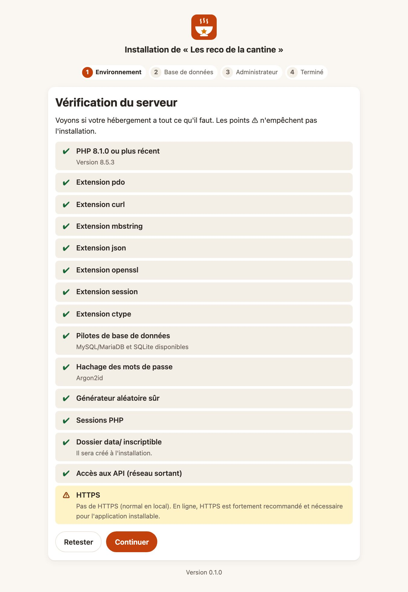</td>
<td width="50%">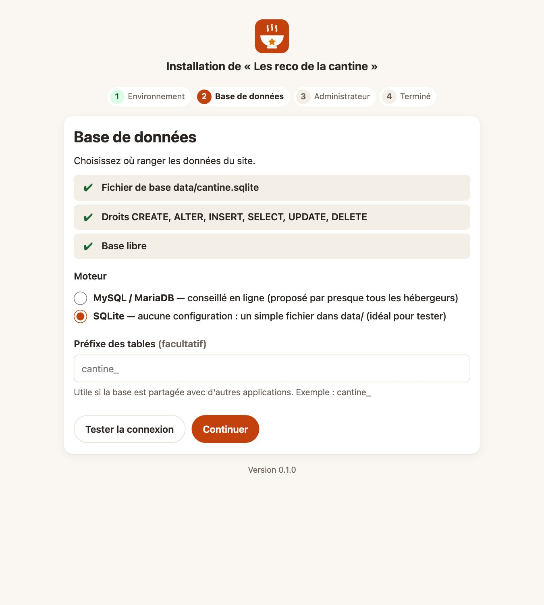</td>
</tr>
<tr>
<td><b>① Vérification du serveur.</b> Une liste ✔ / ⚠ / ✘. Les ⚠ sont de simples avertissements ; un ✘ s'accompagne d'une explication, corrigez-le puis cliquez sur « Retester ».</td>
<td><b>② Base de données.</b> Choisissez MySQL/MariaDB (et saisissez les informations notées à l'étape 0) ou SQLite. « Tester la connexion » explique chaque problème en clair : mauvais mot de passe, base introuvable, droits manquants…</td>
</tr>
<tr>
<td>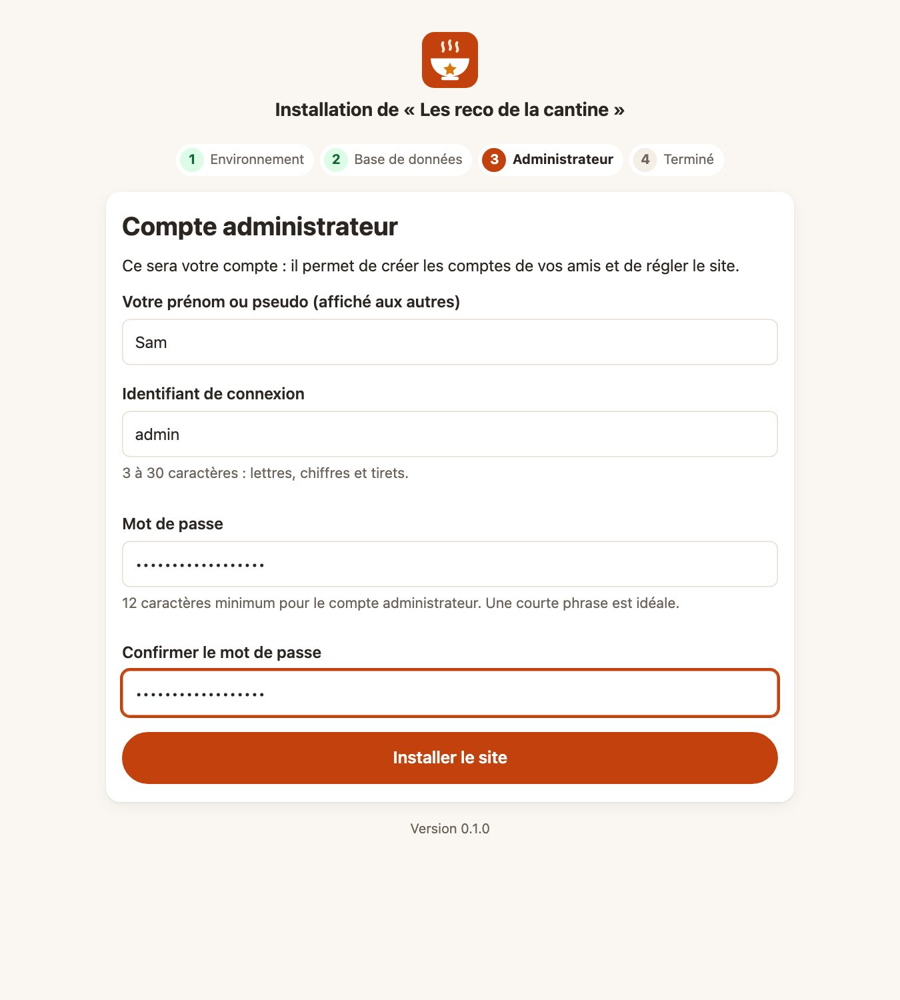</td>
<td>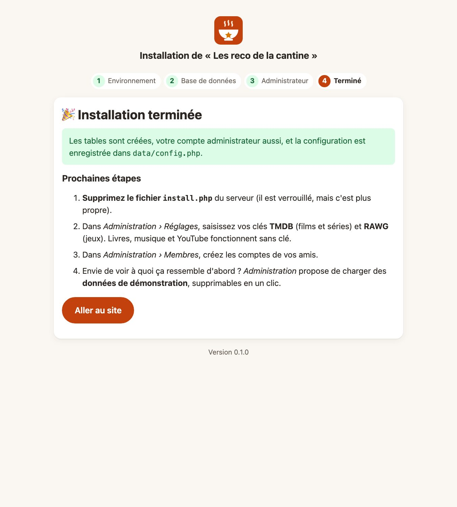</td>
</tr>
<tr>
<td><b>③ Votre compte administrateur.</b> Votre prénom, un identifiant et un mot de passe d'au moins 12 caractères (une petite phrase, c'est parfait).</td>
<td><b>🎉 C'est installé !</b> L'installeur crée les tables, le dossier <code>data/</code> et la configuration, puis se verrouille.</td>
</tr>
</table>

Ensuite, **supprimez le fichier `install.php`** du serveur (il est verrouillé, mais c'est plus propre).

### Étape 4 — Protéger le dossier des données

⚠️ Le dossier `data/` contient la configuration, la base SQLite éventuelle, les journaux et les sauvegardes. Il **ne doit jamais être lisible depuis le web**.

- **Serveur Apache** (la majorité des hébergements mutualisés) : rien à faire, les fichiers `.htaccess` fournis s'en chargent.
- **Serveur nginx** (VPS, YunoHost…) : nginx ignore les `.htaccess`. Ajoutez la règle donnée dans [Configuration du serveur web](#-configuration-du-serveur-web).

**Vérifiez dans tous les cas** : connectez-vous, allez dans **Administration › Diagnostic** et regardez la ligne *« Dossier data/ protégé du web »*. Elle doit être verte.
Vous pouvez aussi ouvrir `https://votre-site/data/.probe` : vous devez obtenir une erreur (403 ou 404), pas une page qui affiche `cantine-probe`.

### Étape 5 — Brancher les recherches automatiques

Les **livres** (Open Library), la **musique** (Deezer) et **YouTube** fonctionnent tout de suite, sans rien configurer.
Pour les **films, séries** et **jeux vidéo**, il faut deux clés gratuites (5 minutes chacune) :

<details>
<summary><b>🎬 Obtenir la clé TMDB (films et séries)</b></summary>

1. Créez un compte sur [themoviedb.org](https://www.themoviedb.org/signup) et confirmez votre e-mail.
2. Allez dans votre profil › **Paramètres › API**, puis demandez une clé pour un usage **personnel**.
3. Copiez la **clé d'API** (32 caractères) **ou** le **jeton d'accès en lecture** (long texte qui commence par `eyJ`) : les deux fonctionnent.
4. Sur le site : **Administration › Réglages**, collez la clé, **Enregistrer**, puis **Tester la clé TMDB** → ✔.

</details>

<details>
<summary><b>🎮 Obtenir la clé RAWG (jeux vidéo)</b></summary>

1. Créez un compte sur [rawg.io](https://rawg.io/signup).
2. Rendez-vous sur [rawg.io/apidocs](https://rawg.io/apidocs) et cliquez sur **Get API Key**.
3. Collez la clé dans **Administration › Réglages**, **Enregistrer**, puis **Tester la clé RAWG** → ✔.

</details>

Sans clé, rien ne casse : la recherche de ce type est simplement remplacée par l'ajout manuel.
Les clés restent sur votre serveur : jamais envoyées aux navigateurs, jamais dans les journaux, exclues des sauvegardes par défaut.

### Étape 6 — Inviter les copains

Il n'y a pas d'inscription publique : c'est vous qui créez les comptes.

1. **Administration › Membres › Créer un compte** : nom affiché + identifiant.
2. Laissez le site **générer un mot de passe provisoire** facile à dicter (du genre `pomme-radis-tulipe-42`). Il s'affiche **une seule fois** : envoyez-le à votre ami.
3. À sa première connexion, il choisira son propre mot de passe.

> 🔑 **Mot de passe oublié ?** Pas d'e-mail automatique : l'administrateur clique sur *Réinitialiser le mot de passe* dans la fiche du membre.

### Étape 7 — Installer l'appli sur le téléphone

Le site s'installe comme une application, avec son icône sur l'écran d'accueil :

- **Android (Chrome)** : menu ⋮ › **Installer l'application** (ou *Ajouter à l'écran d'accueil*).
- **iPhone (Safari)** : bouton Partager › **Sur l'écran d'accueil**.

### 🧪 Envie d'essayer avant d'inviter tout le monde ?

**Administration › Données de démonstration › Charger** : 4 faux membres et une vingtaine de contenus apparaissent, avec des notes et des commentaires.
Quand vous avez fini : **Supprimer les données de démo**, et vos vraies données restent intactes.

---

## 🏠 Cas particulier : YunoHost

Le site s'installe très bien sur un serveur [YunoHost](https://yunohost.org/) avec l'application **My Webapp** :

1. Dans l'administration YunoHost, installez **My Webapp** sur le domaine et le chemin de votre choix, avec **PHP** et une base **MySQL** activés.
2. Récupérez l'accès SFTP et les identifiants de la base dans les informations de l'application.
3. Envoyez les fichiers dans le dossier `www/` de l'application, puis suivez le tutoriel à partir de l'[étape 3](#étape-3--lancer-linstalleur).
4. YunoHost utilise **nginx** : ne sautez pas l'[étape 4](#étape-4--protéger-le-dossier-des-données). Ajoutez la règle nginx de la section suivante à la configuration du site (accès SSH nécessaire), puis vérifiez le *Diagnostic*.

> Les écrans et les chemins exacts peuvent varier selon la version de YunoHost et de My Webapp.

---

## 🔄 Mettre à jour

Vos données et votre configuration vivent dans `data/`, qui ne fait **jamais** partie des archives : une mise à jour ne les touche pas.

1. **Administration › Sauvegarde** : téléchargez une sauvegarde, par prudence.
2. **Administration** : activez le **mode maintenance** (vos amis voient une page « On remet un peu d'ordre en cuisine », vous gardez l'accès).
3. Téléchargez la nouvelle release et envoyez les fichiers **par-dessus** les anciens, sans toucher à `data/`. Supprimez ensuite `install.php`.
4. Si la nouvelle version modifie la base, le site vous propose **Mettre à jour la base** : un clic.
5. Désactivez le mode maintenance.

Le [`CHANGELOG.md`](CHANGELOG.md) indique pour chaque version si une mise à jour de la base est incluse.

## 💾 Sauvegarder et restaurer

Tout se passe dans **Administration › Sauvegarde** :

- **Télécharger une sauvegarde** : un fichier `cantine-sauvegarde-AAAA-MM-JJ.json` avec les comptes, contenus, statuts, notes, commentaires et réglages.
  Il contient les mots de passe **chiffrés** des membres : rangez-le en lieu sûr.
- **Restaurer** : le fichier est entièrement vérifié **avant** tout changement, un résumé s'affiche, puis vous confirmez avec votre mot de passe.
  La restauration se fait d'un bloc (tout ou rien), précédée d'une **sauvegarde de sécurité** automatique de l'état actuel.
- **Portable** : une sauvegarde MySQL se restaure sous SQLite et inversement ; une sauvegarde d'une ancienne version se restaure sur une version plus récente. Pratique pour déménager !

## 🌐 Configuration du serveur web

Le site fonctionne même quand **tout le dossier** est servi tel quel (cas de la plupart des hébergements).
Les dossiers internes (`app/`, `migrations/`, `data/`) sont protégés de trois façons : fichiers `.htaccess`, règle nginx ci-dessous, et une garde PHP en tête de chaque fichier de code.

**Apache** : rien à faire (`AllowOverride All`, activé par défaut chez la plupart des hébergeurs).

**nginx + PHP-FPM** : ajoutez ces règles au bloc `server` :

```nginx
# Dossiers internes et fichiers sensibles : interdits
location ~ ^/(app|migrations|data|tests|tools)/ { deny all; return 404; }
location ~ /\.                                  { deny all; return 404; }
location ~ \.(md|sh|lock|sqlite|log)$           { deny all; return 404; }

index index.php;

location ~ \.php$ {
    include fastcgi_params;
    fastcgi_param SCRIPT_FILENAME $document_root$fastcgi_script_name;
    fastcgi_pass unix:/run/php/php8.3-fpm.sock;   # à adapter à votre version de PHP
}

location = /sw.js { add_header Cache-Control "no-cache"; }
```

Site dans un sous-dossier ? Préfixez les chemins : `^/cantine/(app|migrations|data|tests|tools)/`.

<details>
<summary><b>⚙️ Options avancées de <code>data/config.php</code></b></summary>
<br>

| Option | Rôle |
|---|---|
| `base_url` | Adresse du site, à remplir seulement si elle est mal détectée (ex. `'https://cantine.example.org/'`). |
| `trust_proxy` | `true` si le site est derrière un proxy inverse qui transmet `X-Forwarded-Proto` / `X-Forwarded-For`. |
| `timezone` | Fuseau d'affichage des dates (`Europe/Paris` par défaut). |
| `session_idle` | Déconnexion après inactivité, en secondes (2 h par défaut). La case « Rester connecté » garde la session 30 jours. |
| `debug` | `true` pour afficher le détail des erreurs. **À ne jamais laisser activé en ligne.** |

</details>

## 🩺 Dépannage

| Symptôme | Solution |
|---|---|
| Page blanche ou « Erreur inattendue » | Lisez `data/logs/app.log`. En local, passez `'debug' => true` dans `data/config.php`. |
| « La base de données est injoignable » | Vérifiez les identifiants dans `data/config.php` et que MySQL tourne. |
| « Le formulaire a expiré » | La page est restée ouverte longtemps : rechargez-la. |
| La recherche de films ne donne rien | Clé TMDB absente ou refusée : *Réglages › Tester la clé TMDB*. Vérifiez aussi le réseau sortant dans *Diagnostic*. |
| Alerte rouge « data/ lisible depuis le web » | Apache : vérifiez que les `.htaccess` sont pris en compte. nginx : ajoutez les règles ci-dessus. |
| L'appli ne s'installe pas sur le téléphone | Le site doit être en `https://`. |
| « Trop de tentatives » à la connexion | Après 5 échecs en 15 minutes, l'attente augmente (jusqu'à 15 min). Patientez, ou faites réinitialiser le mot de passe. |
| Fichier de sauvegarde « trop volumineux » | Augmentez `upload_max_filesize` et `post_max_size` dans la configuration PHP (les limites actuelles sont affichées sur la page). |

<details>
<summary><b>Mot de passe administrateur perdu, ou <code>config.php</code> perdu</b></summary>
<br>

**Mot de passe admin perdu** : un autre administrateur peut le réinitialiser. Sinon, restaurez une sauvegarde, ou remplacez la colonne `password_hash` du compte en base
par le résultat de `php -r "echo password_hash('nouveau-mot-de-passe', PASSWORD_DEFAULT);"`.

**`data/config.php` perdu** : l'installeur refuse une base qui contient déjà un site (pour ne rien écraser). Recréez simplement le fichier :

```php
<?php
defined('CANTINE') || exit;
return [
    'db' => ['driver' => 'mysql', 'host' => 'localhost', 'port' => '', 'name' => 'ma_base', 'user' => 'mon_utilisateur', 'password' => '...', 'prefix' => ''],
    // ou : 'db' => ['driver' => 'sqlite', 'path' => 'cantine.sqlite', 'prefix' => ''],
    'secret' => 'une-longue-chaine-aleatoire',
    'site_name' => 'Les reco de la cantine',
    'base_url' => '',
    'trust_proxy' => false,
    'timezone' => 'Europe/Paris',
    'session_idle' => 7200,
    'debug' => false,
];
```

</details>

---

## 👩‍💻 Pour les développeurs

**Lancer le site en local** (seul PHP est nécessaire) :

```bash
git clone https://github.com/collet-david-pro/les-reco-de-la-cantine.git
cd les-reco-de-la-cantine
php -S localhost:8000 tools/dev-router.php
```

Ouvrez <http://localhost:8000/>, choisissez SQLite dans l'installeur, c'est prêt. Pour repartir de zéro : supprimez le dossier `data/`.
Le petit routeur `tools/dev-router.php` remplace les `.htaccess`, que le serveur intégré de PHP ignore.

**Organisation du code**

```
index.php            contrôleur frontal (toutes les pages : index.php?route=…)
install.php          installeur
app/
  Controllers/       une classe par écran (Admin/ pour l'administration)
  Repositories/      requêtes SQL (compatibles MySQL et SQLite)
  Services/          connecteurs d'API (Api/), sauvegarde, démo…
  Support/           base de données, session, CSRF, vues, migrations…
  Views/             gabarits PHP
  lang/fr.php        tous les textes de l'interface
  Types.php          registre des types de contenus
migrations/          évolutions de la base (NNN_description.php)
assets/              CSS, JavaScript, images
```

- **Ajouter un type de contenu** : une entrée dans `app/Types.php` (et un connecteur dans `app/Services/Api/` si besoin). Aucune migration.
- **Changer la palette** : un seul bloc de variables en tête de `assets/css/app.css`. Trois propositions sont visibles dans `assets/palettes.html`.
- **Faire évoluer la base** : nouveau fichier `migrations/NNN_….php` (ne jamais modifier une migration publiée), et si besoin une adaptation des anciennes sauvegardes dans `Backup::upgrade()`.
- **Principes** : PHP 8.1 sans framework ni dépendance, aucun script en ligne (CSP stricte), requêtes préparées partout, échappement systématique, CSRF sur toutes les actions.
- Le document de cadrage complet est dans [`projet.md`](projet.md).

**Tests** (aucun outil à installer, aucun appel réseau) :

```bash
php tests/run.php                       # SQLite
CANTINE_TEST_MYSQL="host=127.0.0.1;name=cantine_test;user=root;password=" php tests/run.php   # SQLite + MySQL
```

**Publier une version** : mettez à jour `VERSION` et `CHANGELOG.md`, lancez les tests sur les deux moteurs, puis `tools/build-release.sh`.
L'archive `dist/cantine-vX.Y.Z.zip` (sans `data/`, tests, outils, documentation de travail) est à joindre à la release GitHub.

**Une faille de sécurité ?** Merci de ne pas ouvrir de ticket public : utilisez l'onglet **Security › Report a vulnerability** du dépôt.

---

## 🙏 Crédits

- Films et séries : [TMDB](https://www.themoviedb.org/). *Ce produit utilise l'API TMDB mais n'est ni approuvé ni certifié par TMDB.*
- Disponibilités « Où regarder » : [JustWatch](https://www.justwatch.com/), via TMDB.
- Livres : [Open Library](https://openlibrary.org/) · Jeux vidéo : [RAWG](https://rawg.io/) · Musique : [Deezer](https://www.deezer.com/) · Vidéos : YouTube (oEmbed).

Distribué sous [licence MIT](LICENSE). Bon appétit ! 🍽️
